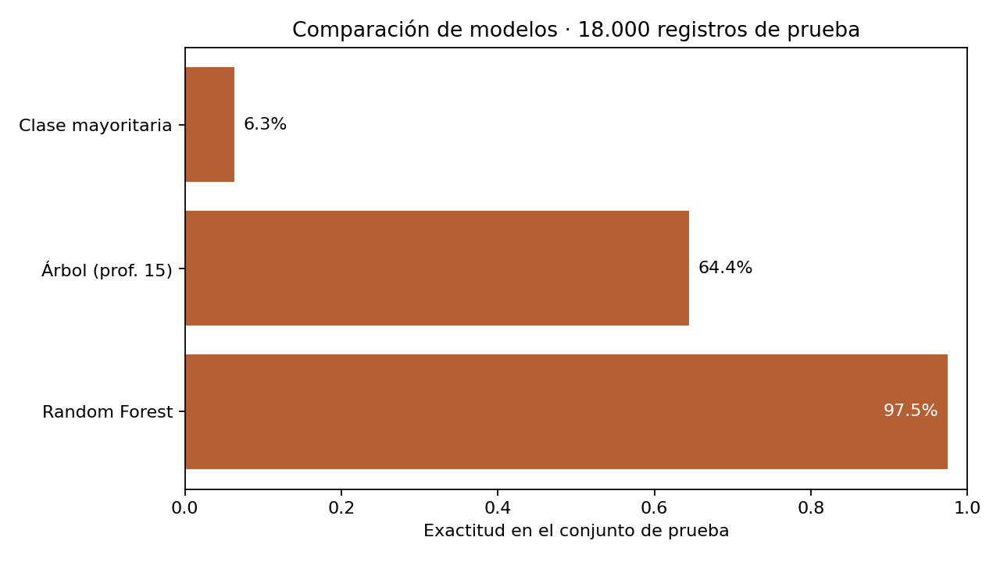

# Clasificación de respuestas de una encuesta de personalidad

Proyecto final del módulo FML del diplomado de la UPB. Analicé un conjunto de respuestas etiquetadas con 16 tipos de personalidad y comparé modelos de clasificación. El caso muestra la preparación de variables, la evaluación con datos separados y los límites de interpretar una exactitud alta.

## Problema

¿Con qué exactitud se pueden reproducir las 16 etiquetas del conjunto a partir de las respuestas a 60 afirmaciones? El objetivo es comparar un árbol de decisión y un Random Forest con una referencia simple de clase mayoritaria, sin presentar el modelo como instrumento de diagnóstico personal.



## Datos

El [CSV](data/Datos_pr.csv) fue entregado por el docente del módulo FML del diplomado de la UPB. Tiene **59.999 registros** y **62 columnas**: un identificador consecutivo, 60 respuestas numéricas entre −3 y 3 y la etiqueta `Personality` con 16 clases. No hay valores faltantes. La fuente original, el periodo de recolección y el procedimiento para asignar las etiquetas no están documentados. [Detalle de los datos](data/README.md).

## Método

Excluí `Response Id` de las variables porque es un número de fila. Separé el 70% de los registros para entrenamiento y el 30% para prueba, conservando la proporción de clases. Comparé una predicción de clase mayoritaria, un árbol de decisión con profundidad máxima 15 y un Random Forest de 100 árboles. Las cifras siguientes proceden del mismo conjunto de prueba de **18.000 registros**, con semilla fija para repetir la comparación.

## Resultados

| Modelo | Exactitud | F1 macro |
| --- | ---: | ---: |
| Clase mayoritaria | 6,28% | 0,0074 |
| Árbol de decisión | 64,40% | 0,6441 |
| Random Forest | **97,48%** | **0,9748** |

El Random Forest reproduce las etiquetas de este archivo con mayor exactitud que el árbol. Las 16 clases están casi equilibradas: cada una reúne entre 3.734 y 3.769 registros. La exactitud observada no acredita que las etiquetas sean válidas fuera de estos datos ni que el modelo generalice a respuestas recogidas de otra manera.

## Aprendizajes

Este proyecto me permitió comparar modelos sobre el mismo conjunto de prueba y ver por qué una métrica alta necesita contexto sobre el origen de los datos y las etiquetas. Si lo repitiera, documentaría cómo se asignó cada tipo de personalidad y contrastaría el modelo con respuestas obtenidas de otra fuente.

## Mi contribución

El docente del módulo entregó los datos y la consigna. En mi trabajo final traduje las preguntas, exploré la distribución de las clases y comparé un árbol de decisión, Bagging y Random Forest. El [notebook](notebooks/trabajo_final.ipynb) muestra ese trabajo; el [script](analysis.py) permite repetir una comparación breve y generar la figura de este README.

## Reproducir

Requiere Python 3.10 o posterior. Desde la raíz del repositorio:

```powershell
python -m pip install -r requirements.txt
python analysis.py
```

El script lee `data/Datos_pr.csv`, imprime las métricas y genera `images/model_comparison.png`. El [notebook](notebooks/trabajo_final.ipynb) permite recorrer el análisis académico completo y localiza el CSV tanto si se abre desde la raíz como desde la carpeta `notebooks`.

## Límites

La encuesta y las etiquetas provienen del mismo conjunto entregado en clase. No se conoce su fuente original ni cómo se asignaron los tipos. La comparación mide desempeño en una partición de este archivo, no calidad de una evaluación psicológica ni resultados esperables en personas nuevas.
